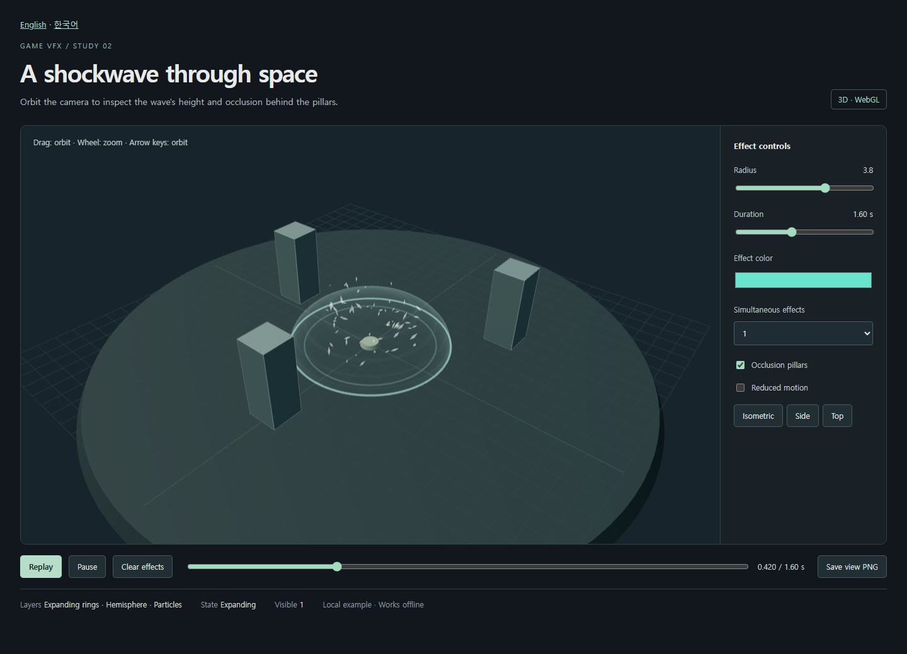

# Game VFX

[English](README.md) | [한국어](README.ko.md) · **v0.4.0**

게임의 아트 스타일과 실제 사건에 맞는 이펙트를 제작하는 AI 에이전트 스킬입니다. 기존 렌더러를 사용해 부드러운 2D 효과, 입자, 궤적, 셰이더, 3D 효과를 만듭니다.

게임 장면이나 참고 이미지를 확인하고, 효과를 만든 뒤 렌더링 결과를 열어 보며 수정합니다. 이후 요청한 내보내기나 게임 연결을 확인합니다. 스킬 패키지에는 지침과 수정 가능한 2D 예제가 있으며, 저장소에는 독립 실행 3D 예제도 포함했습니다. 완성된 효과 모음이나 모든 엔진의 지원을 보장하는 도구는 아닙니다.



## 예제 실행

저장소를 다운로드하거나 복제한 뒤 아래 HTML 파일을 브라우저로 여세요. GitHub의 파일 화면에서는 소스가 표시되므로, 내려받은 파일을 열어야 실행됩니다.

| 예제 | 확인할 수 있는 것 |
| --- | --- |
| [2D 스타일](assets/canvas-impact.html) | 충격파·베기·반복 불씨, 크기·프레임 수·시간·색상·시드 조절, PNG·전용 JSON 저장 |
| [Godot 실행 장면](examples/godot-sheet/README.md) | 세 출력을 가져와 종료·일시정지·재시작·소유자 정리 검사 |
| [이벤트 재생](examples/event-replay/index.html) | 로컬 소유권·정정·종료·라운드 정리. README의 로컬 서버 실행 필요 |
| [3D 충격파](examples/shockwave-3d/shockwave-3d.html) | 반구형 파동·고리·입자를 카메라로 회전해서 보기, 물체 가림, 1·3·6개 동시 표시 |

2D·3D 독립 예제는 인터넷 없이 실행됩니다. 이벤트 재생은 로컬 HTTP 서버를 사용합니다. 3D 예제는 WebGL2가 필요합니다. PNG 버튼은 현재 카메라의 화면을 저장하며, 3D 모델이나 투명 효과 에셋을 내보내는 기능은 아닙니다. 수정 방법은 [소스와 빌드 안내](examples/shockwave-3d/README.md)에 있습니다.

## 게임풍에 맞추는 방법

형태, 표면, 색상의 의미, 움직임, 강조 정도, 카메라 크기를 판단할 실제 근거를 살펴봅니다. 게임의 사건과 규칙을 보존하며, 모든 효과에 빛·카메라 흔들림·히트스톱·추가 입자가 필요하다고 가정하지 않습니다.

[bettermakegame](https://github.com/Ddrubok/bettermakegame)과 함께 사용할 때는 다음과 같이 진행합니다.

1. **장면의 목적 정리:** Better Make Game이 사건, 의도한 느낌, 참고 자료, 보존 조건을 짧은 VFX 제작 기준으로 정리합니다.
2. **효과 제작:** Game VFX가 그 기준으로 렌더러를 선택하고 효과를 만든 뒤 결과를 확인합니다.
3. **실제 장면에서 검토:** 게임 안에서 비교하며 스타일의 조화, 기능의 정확성, 실행 비용, 사람의 선호를 구분합니다.

각 스킬은 단독으로도 사용할 수 있습니다. 같은 세션에서 지침을 이어 적용하며 별도 에이전트나 연동 서버를 요구하지 않습니다. 참고 자료나 실행 환경이 없으면 추정한 부분과 미검증 항목을 밝혀야 합니다. 색상만 바꾸었다고 스타일이 맞는 것으로 판정하지 않습니다. 자세한 기준은 [style-and-handoff.md](references/style-and-handoff.md)에 있습니다.

## 설치와 사용

`SKILL.md`, `LICENSE`, `agents/`, `references/`, `assets/`를 함께 보관하고, 에이전트가 인식하는 스킬 위치에 `game-vfx`라는 폴더로 두세요. 저장소를 다운로드하거나 복제할 수 있습니다.

```sh
git clone https://github.com/Ddrubok/game-vfx.git
```

관리자의 Orca 설정은 `~/.codex/skills/game-vfx`를 인식합니다. 다른 설정에서는 경로가 다를 수 있습니다. 호스트가 지원하는 위치를 사용하고, 업데이트 시 로컬 변경을 보존하며 중복 설치를 피하세요. 저장소의 `examples/`와 `docs/`는 선택적인 예제·검증 자료이며, 매 작업에서 반드시 읽는 실행 지침이 아닙니다.

지침 패키지에는 별도 API 키나 MCP 서버가 필요하지 않습니다. 실제 작업에는 프로젝트에 접근하고 편집·렌더링·이미지 확인을 할 수 있는 에이전트 도구가 필요합니다. Claude·Gemini 등에도 Markdown 파일을 제공할 수 있지만, 호스트별 자동 검색·활성화를 모두 시험한 것은 아닙니다. `agents/openai.yaml`은 선택적인 Codex 표시용 정보입니다.

다음은 셸 명령이 아닌 에이전트에게 보내는 요청입니다. `$스킬이름` 표기는 Codex 호출 예시입니다.

```text
$game-vfx 현재 프로젝트에 부드러운 얼음 타격 효과를 만들어 주세요.
기존 아트 스타일과 렌더러를 사용하고 충돌 규칙은 유지해 주세요.
미리보기와 요청한 게임 연결을 확인하고, 미검증 항목을 알려 주세요.
```

```text
$bettermakegame $game-vfx
게임의 디자인 자료와 실제 장면을 보고 게임풍에 맞는 충돌 효과를 만들어 주세요.
턴 규칙을 유지하고 반복 충돌에서도 선택 표시가 잘 보이게 해 주세요.
```

```text
$game-vfx 제공한 스타일 참고 자료와 이 효과를 비교해 주세요.
게임을 수정하지 말고 차이와 근거만 보고해 주세요.
```

## 실제로 확인한 범위

- 수정한 2D 내보내기는 2026-11-05 브라우저·내보내기 검사 25개를 통과했습니다. 첫 프레임 표시, 0.8초 재생 시간 유지, 저장한 20개 프레임과 개별 출력의 일치를 확인했습니다. 마지막 페이드 표본은 8비트 출력에서 완전히 투명합니다. 이전 23개 검사는 과거 기록으로 보존합니다.
- 3D 예제는 조건을 고정한 물체 가림 비교, 재생, 6개 동시 표시, 반복 생성·정리 등 자동 검사 28개를 통과했습니다. 확인한 반복 구간에서 추적한 자원 수가 증가하지 않았습니다.
- 최종 정지 화면을 직접 열어 확인했습니다. 연결된 스킬 지침의 메타데이터·상대 링크·공백 오류도 검사했습니다.

결과는 기록한 예제와 조건에 한정됩니다. 움직임의 주관적인 질, 모든 메모리 누수의 부재, 휴대폰 성능, Unity·Godot·Unreal·Flutter의 일반적인 연동을 입증하지 않습니다. 아래 v0.4.0 Godot 장면은 제한된 별도 엔진 실행 기록입니다. **새 스타일 연계의 독립적인 전체 실행 평가는 NOT RUN(미실행)입니다.** 근거와 한계는 [검증 기록](docs/validation.md)에 있습니다.

## v0.3.1 변경

재생 시간과 구간 중간의 표본 시점을 구분하여 첫 저장 프레임이 비는 문제를 고쳤습니다. 선택적으로 사용하는 이벤트 어댑터·실제 렌더링 재생 예제, 이식 가능한 Canvas 검사기, 엔진 판별·가져오기 안내, **NOT RUN(미실행)**으로 표시한 Godot 참조 코드를 추가했습니다. 종료된 효과는 높은 revision으로도 다시 나타나지 않고, 콜백은 소유자의 재사용 세대를 구분합니다. 일반 알파 합성과 단일 충격파 스타일은 예제의 범위로 유지했습니다.

로컬 이벤트 어댑터는 Node 검사 13개와 브라우저 검사 11개를 통과했습니다. 수정된 bettermakegame 공통 예제도 13개 검사를 통과했습니다. 이전 9개 검사 기록은 놓친 회귀를 명시해 보존했습니다. 이 통과 결과로 엔진 참조 코드·실제 네트워크/기기·스킬 전달 행동을 검증했다고 보지 않습니다. [수정 기록](docs/feedback-repair-2026-11-05.md), [Canvas 검사기](examples/canvas-verification/README.md), [이벤트 재생](examples/event-replay/README.md)에 근거와 실행법이 있습니다.

## v0.3.0 변경

v0.3.0에는 [이벤트 연결 안내](references/event-integration.md)를 추가했습니다. 처리 중·확정 신호, 중복·순서가 바뀐 이벤트, 결과 정정, 소유자·라운드 종료를 다룹니다. kill-game-slop의 발견 사항은 직접 받거나 bettermakegame의 제작 기준을 거쳐 받을 수 있으며, 두 경로 모두 판단 유형·작업 범위·증거의 한계를 유지합니다. 작은 효과 하나에 세 스킬을 모두 쓸 필요는 없습니다. 검사와 미실행 평가는 [업데이트 기록](docs/update-2026-11-05.md)에 있으며, 이전 예제 결과는 새 지침의 검증 결과가 아닙니다.

## 파일과 라이선스

- [engine-adapters.md](references/engine-adapters.md): 엔진 판별·선택적 예제·확인 범위를 밝힌 Godot 시트 재생 장면.
- [event-integration.md](references/event-integration.md): 상태 표현, 순서, 수명과 범위에 맞는 연결 검사.
- [SKILL.md](SKILL.md): 작업 범위, 진행 방식, 근거 기록 규칙
- [style-and-handoff.md](references/style-and-handoff.md): 아트 방향과 제작 기준·결과 전달
- [implementation-and-export.md](references/implementation-and-export.md): 렌더러 선택과 내보내기
- [visual-validation.md](references/visual-validation.md): 시각·움직임·연동·성능 확인

이 저장소의 자체 작성 자료는 MIT 라이선스입니다. 3D 예제에는 MIT 라이선스의 Three.js가 포함됩니다. 참고한 작업 방식과 외부 코드 고지는 [NOTICE.md](NOTICE.md)에 있습니다. pixelfx의 코드·효과·글꼴은 포함하지 않았습니다.

## 실제 적용 후속 작업 — 2026-11-05

[현재 수정·검증 기록](docs/practical-validation-2026-11-05.md)에 이전 라운드의 늦은 종료 콜백 수정, 실제 게임 구성요소 수리, 새 Astra 4세션 비교를 정리했습니다. 과거 결과는 보존했습니다. 짧은 지침과 전체 스킬 모두 선택 과제를 고쳤고 정상 축하 화면은 유지했습니다. 추가 정확도 우위는 확인되지 않았습니다. 원본 게임 프로젝트는 수정하지 않았습니다. 사람·실기기·네트워크와 별도 U/V·전달 평가 묶음은 미실행입니다.

## v0.4.0 변경

[2D 예제](assets/canvas-impact.html)에서 충격파·베기·반복 불씨를 선택하고 해상도·프레임 수·지속 시간을 조절합니다. [Godot 4.4.1 프로젝트](examples/godot-sheet/README.md)는 세 출력을 가져와 실행하며 네이티브 검사 16개를 통과했습니다. 기본 Canvas 25개, 변형 출력 18개, 로컬 이벤트 13개, 렌더링 재생 11개도 통과했습니다. 예제 검사이며 모든 엔진 지원이나 스타일 품질의 입증은 아닙니다. 작은 시트의 RGBA8 픽셀 데이터는 0.75–1MiB, 기본값은 20MiB입니다. 실제 GPU 메모리나 같은 체감 품질은 측정하지 않았습니다.

[2026-11-06 review follow-up / v0.4.1](docs/review-followup-2026-11-06.md): input validation, bounded events, atomic Godot import, timing checks and non-color state cues.

[Paired comparison and score tables / 2026-11-06](docs/comparison-2026-11-06.md): 12 sessions; both conditions passed 90/90 functional checks. The single blinded style review preferred the baseline; no general skill advantage was established.
