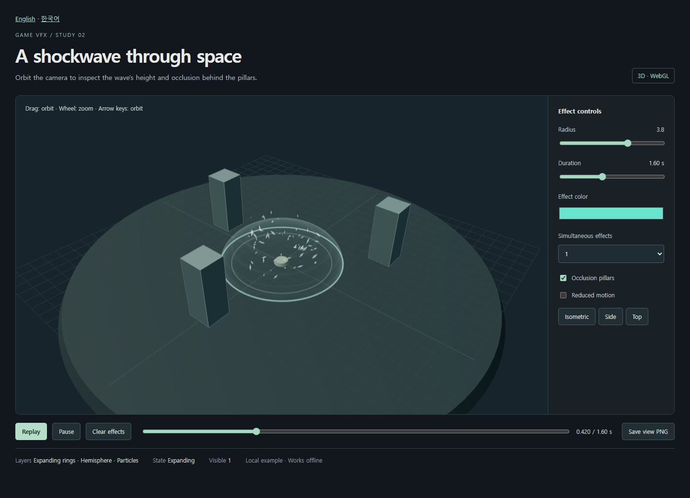

# Game VFX

[English](README.md) | [한국어](README.ko.md) · **v0.3.0**

An AI agent skill for making game effects that fit the project's art direction and actual events. It covers smooth 2D effects, particles, trails, shaders, and 3D effects using the project's renderer.

The agent starts with the game scene or visual references, makes an effect, renders it, inspects the result, and adjusts it. It then checks the requested export or integration. The package contains instructions and an editable 2D example; this repository also includes a standalone 3D example. It is not a catalog of finished effects or a guarantee that every engine is supported.



## Try the examples

Download or clone the repository, then open these HTML files in a suitable browser. GitHub's file viewer shows source; open the downloaded file to run it.

| Example | What it does |
| --- | --- |
| [2D impact](assets/canvas-impact.html) | Preview a smooth ring and sparks; change color/seed; save a transparent PNG or sheet plus custom JSON. |
| [3D shockwave](examples/shockwave-3d/shockwave-3d.html) | Rotate the camera around a hemisphere, rings, and particles; inspect occlusion; show 1, 3, or 6 effects. |

Both run offline. The 3D example requires WebGL2. Its PNG button saves the current camera view, not a 3D model or a transparent effect asset. Read its [source and build guide](examples/shockwave-3d/README.md) to modify it.

## Fit the game's style

The skill examines useful evidence for shape, surface, color meaning, motion, emphasis, and camera scale. It preserves the game's actual event and rules. It does not assume that every effect needs glow, camera shake, hit-stop, or more particles.

For work with [bettermakegame](https://github.com/Ddrubok/bettermakegame):

1. **Define the moment.** Better Make Game records the event, intended feeling, references, and preservation conditions in a short VFX brief.
2. **Produce the effect.** Game VFX uses that brief to choose a renderer, create the effect, and inspect the output.
3. **Review in context.** Compare the result in the actual scene, keeping style fit, functional correctness, runtime cost, and player preference separate.

Each skill works alone. This handoff uses instructions in the same session; it does not launch extra agents or require a service. If a reference or runtime is missing, the agent must say which choices are provisional and which checks remain unverified. A palette change alone is not proof of a style match. See [style-and-handoff.md](references/style-and-handoff.md).

## Install and use

Keep `SKILL.md`, `agents/`, `references/`, and `assets/` together in a folder named `game-vfx` in a skill location recognized by your agent. Download this repository or clone it:

```sh
git clone https://github.com/Ddrubok/game-vfx.git
```

The maintainer's Orca setup recognizes `~/.codex/skills/game-vfx`. Other configurations may use another directory. Use your host's supported location, preserve local changes when updating, and avoid duplicate installations. The repository's `examples/` and `docs/` are optional demonstration and maintainer material, not instructions that every task must read.

The instruction package needs no separate API key or MCP server. It still needs an agent with access to the project and suitable editing, rendering, and image-viewing tools. Other hosts, including Claude and Gemini, can be given the Markdown files; automatic discovery and activation have not been tested across hosts. `agents/openai.yaml` is optional Codex display metadata.

These are messages to an agent, not shell commands. The `$skill-name` notation is a Codex invocation example.

```text
$game-vfx Create a smooth ice-impact effect for this project.
Use its existing art direction and renderer. Preserve collision rules.
Show a preview and check the requested integration; report untested parts.
```

```text
$bettermakegame $game-vfx
Use this game's design references and scene to make a matching collision
effect. Keep turn rules and selection cues readable during repeated hits.
```

```text
$game-vfx Review this effect against the supplied style reference.
Report differences and evidence without modifying the game.
```

## What has been checked

- The 2D example passed 23 automated browser/export checks on 2026-11-04. Its saved sheet frames matched individually exported PNG frames in that environment.
- The 3D example passed 28 automated checks, including a controlled occlusion comparison, playback, six simultaneous effects, and repeated creation/cleanup. Its tracked resource counts did not grow during the sampled cycles.
- Final static captures were opened for visual inspection. The linked skill instructions passed metadata, relative-link, and whitespace checks.

These results are limited to the recorded examples and conditions. They do not prove subjective motion quality, general leak freedom, mobile performance, or Unity/Godot/Unreal/Flutter integration. **Independent end-to-end evaluation of the new style handoff is NOT RUN.** See the [validation record](docs/validation.md) for evidence and limits.

## Version 0.3.0

Version 0.3.0 adds [event integration guidance](references/event-integration.md): pending versus confirmed cues, duplicate/reordered events, corrections and owner/round cleanup. Findings from kill-game-slop retain their judgment, scope and evidence limits through the bettermakegame brief. A local effect does not require all three skills. See the [update record](docs/update-2026-11-05.md) for checks and remaining evaluations; the earlier example results do not validate the new instructions.

## Files and license

- [SKILL.md](SKILL.md): task scope, workflow, and evidence rules.
- [style-and-handoff.md](references/style-and-handoff.md): visual direction and brief/result exchange.
- [event-integration.md](references/event-integration.md): state truth, ordering, lifetime and bounded integration checks.
- [implementation-and-export.md](references/implementation-and-export.md): renderer selection and export details.
- [visual-validation.md](references/visual-validation.md): visual, motion, integration, and performance checks.

This repository's original material is MIT licensed. The 3D example includes Three.js under its MIT license. Workflow inspiration and third-party notices are in [NOTICE.md](NOTICE.md). No pixelfx code, effects, or fonts are bundled.
