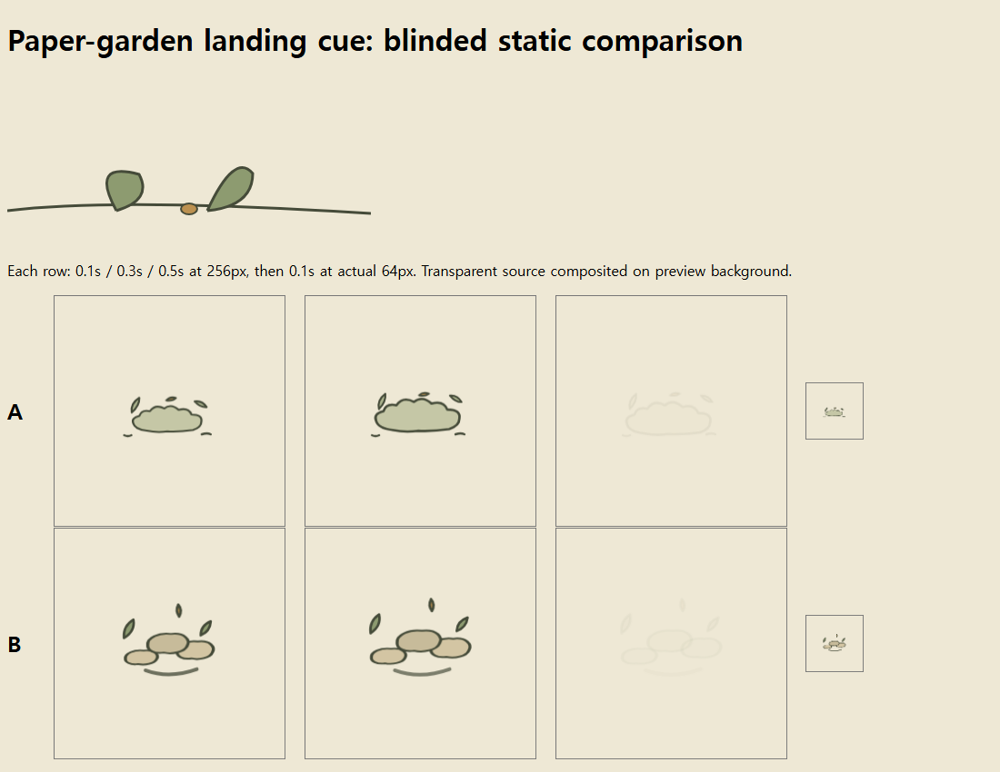

# game-vfx v0.4.1 비교 실험 — 2026-11-06

[English](comparison-2026-11-06.md) | [한국어](comparison-2026-11-06.ko.md)

**후속 재검토:** 아래 90/90은 당시 검사 결과다. 추가한 pending 완료 콜백 사례에서는 기본 제출물이 통과하고 전체 스킬 제출물이 실패했다. 원본·점수·해시는 보존했으며, [별도 수정 패치와 회귀 결과](recheck-followup-2026-11-06.ko.md)를 추가했다.

**이번 소규모 비교에서는 전체 스킬의 추가 품질 우위가 확인되지 않았다.** 기본 지침과 전체 스킬 모두 공통 기능 검사 90/90개를 통과했다. 스타일 과제 1건의 블라인드 AI 평가는 기본 지침 결과를 선호했다. 이는 기본 지침이 항상 더 낫다는 결론도 아니다.

## 방법

GPT-6 Sol, medium reasoning으로 6개 과제 × 2조건 = 12개 독립 세션을 실행했다. 두 조건의 요청과 시작 파일은 과제별로 동일하며, 기본 조건에는 “요청한 효과를 만들고 게임 규칙을 보존하며 결과를 확인하라”는 짧은 지침을 제공했다. 전체 조건에는 수정된 v0.4.1 본문·참조·번들 에셋을 제공했다. 따라서 문장 길이만의 효과가 아닌 전체 패키지의 추가 가치를 비교한다.

작업 디렉터리를 분리하고 실행 순서를 사전에 무작위화했다. 동일한 Windows 호스트에서 최대 4세션이 병렬 실행됐다. 각 세션에 약 4분의 작업 예산을 요청했으며 실제 실행은 136~210초였다. 실행 시간은 도구 시작·검사·수정·최종 응답을 포함하고 대기열 시간은 제외한다. 도구는 Node 22.18.0, 설치된 Playwright/Chromium, Godot 4.7.1을 사용했다.

재색상·동작 감소·Godot 가져오기는 예제 기반 수정이다. 스타일은 새로 만든 종이 정원 참조 장면, 루프와 이벤트는 새로 지정한 합성 요구사항이다. 실제 출시 게임이나 실제 네트워크를 사용한 평가는 아니다. 이벤트 과제에는 “미리보기 만료 후 확정이 와도 0.8초 전체 확정 단계를 반드시 한 번 표시한다”는 명시적 계약을 제공했다.

검증기는 작업자가 결과를 만드는 동안 별도로 작성했다. 제출된 구현을 수정하지 않고 동일 검사를 적용했다. 스타일은 별도의 Sol 평가자에게 조건명을 숨긴 A/B 캡처를 주어 평가했다. 평가자에게 제작 과정·점수 예상·자동 검사 결과는 전달하지 않았다.

## 결과

| 과제 | 기본 지침 기능 검사 | 전체 스킬 기능 검사 | 기본 소요 시간 | 전체 소요 시간 |
| --- | ---: | ---: | ---: | ---: |
| 재색상 | 6/6 | 6/6 | 145초 | 162초 |
| 종이 정원 스타일 제작 | 4/4 | 4/4 | 136초 | 210초 |
| 반복 불씨 루프 | 7/7 | 7/7 | 141초 | 153초 |
| 동작 감소와 상태 구분 | 6/6 | 6/6 | 156초 | 139초 |
| Godot 가져오기 | 54/54 | 54/54 | 200초 | 156초 |
| 지연·중복 이벤트 | 13/13 | 13/13 | 172초 | 164초 |
| 합계 | **90/90** | **90/90** | **950초** | **984초** |

90개 검사는 독립 표본 90개를 뜻하지 않는다. 특히 Godot 54개는 정상 입력 6개와 비정상 입력 24종의 거부·상태 보존 검사 48개다. 두 조건 모두 새 검사 환경의 가져오기와 런타임 종료 코드가 0이었고 스크립트 오류가 없었다. 기능 검사는 알파·수명·재현성·루프 경계·동작 감소·이벤트 계약 등을 확인하며 미적 품질 점수가 아니다.

### 스타일 블라인드 평가

최종 익명화에서 A는 기본 지침, B는 전체 스킬이었다. 평가자는 이 대응표를 보지 않았다.

| 항목, 5점 척도 | 기본 지침 A | 전체 스킬 B |
| --- | ---: | ---: |
| 참조 스타일 일치 | 4 | 3 |
| 64px 판독성 | 4 | 3 |
| 시각적으로 확인 가능한 요구 부합 | 4 | 3 |

평가자는 A의 연결된 구름 실루엣이 착지 먼지로 더 명확하게 읽힌다고 판단했다. B의 분리된 타원은 작은 돌이나 거품처럼 보이고, 아래 곡선은 부분적인 링처럼 읽힌다고 설명했다. 두 결과 모두 차분한 색과 평면 윤곽이라는 큰 방향은 지켰다. 이 평가는 한 명의 AI가 한 과제의 정지 캡처를 본 결과다. 실제 사람의 선호나 연속 동작의 느낌을 입증하지 않는다.

### 작업량

| 누적 지표, 제작 6세션 합계 | 기본 지침 | 전체 스킬 |
| --- | ---: | ---: |
| 입력 토큰, 캐시 포함 | 2,189,275 | 2,748,621 |
| 입력 중 캐시되지 않은 토큰 | 86,107 | 105,805 |
| 출력 토큰 | 39,757 | 39,149 |
| 작업자 자체 보고 수정 횟수 | 9 | 8 |

전체 조건의 합산 시간은 약 3.5%, 캐시되지 않은 입력은 약 22.9% 많았다. 출력은 약 1.5% 적었다. 도구 호출마다 누적된 CLI 사용량이며 고유 문서 길이나 청구 금액이 아니다. 수정 횟수는 작업자의 자체 보고라 검사 스크립트 재시도와 동일한 지표가 아니다. 한 번의 실행과 공유 호스트로 속도·비용 차이를 일반화할 수 없다. 평가자와 공통 검증기의 작업량은 이 표에서 제외했다.

## 검증·격리 점검과 한계

- 12세션 모두 완료됐으며 실패한 세션을 제외하거나 좋은 결과만 골라 재실행하지 않았다. 제작 중 명령·패치·검사 재시도는 원시 로그에 보존했다. 불필요한 로컬 MCP 연결 오류가 공통 환경 로그에 있었지만 최종 필수 도구 검사는 완료됐다.
- 각 조건의 REQUEST.md가 동일한지 확인했다. 기본 조건이 전체 스킬 내용을 읽었다는 증거는 명령 기록에서 발견하지 못했다. 동작 감소 기본 세션이 없는 `skill` 폴더를 나열하려다 실패한 기록은 있다. 전역 스킬 목록은 호스트에 노출될 수 있고, 파일 접근 격리는 지침 기반이므로 완전한 맹검 환경은 아니다.
- 전체 조건은 과제에 맞는 참조를 실제로 읽었다. 사용한 스킬 해시, 입력 요청, 제출 소스 해시와 파일 읽기 기록을 보관했다. 비교한 스킬은 이후 자동으로 수정하지 않았다.
- 이벤트의 첫 검사에서 `0.3999999999999999 === 0.4` 비교 때문에 거짓 실패가 발생했다. 허용 오차 1e-9로 검증기를 고치고 양쪽에 동일 적용했다. 구현은 고치지 않았고 수정 전 결과도 보관했다.
- 루프·동작 감소의 시간 샘플 검증과 정지 캡처 확인은 수행했지만, 사람의 실시간 움직임 평가·실기기 성능·출시 게임 통합은 수행하지 않았다. Godot은 headless 검사다.
- 조건별·과제별 표본은 1개다. 요청 자체에 판정 기준을 상세히 써 두었기 때문에 기본 지침도 강한 요구사항을 받았다. 이는 모호한 실제 요청에서 스킬이 빠진 조건을 발견하는 능력에 대한 시험이 아니며, 두 조건 모두 쉽게 통과하는 천장 효과가 있을 수 있다.

## 해석과 다음 개선 방향

현재 근거로는 스킬을 “항상 더 좋은 VFX를 만드는 방법”으로 소개하기 어렵다. 이번 결과가 뒷받침하는 가치는 조건별 제작·검증 절차를 제공한다는 점이다. 명확한 단순 작업에서는 추가 문서가 품질을 높였다는 증거가 없었다.

당장은 규칙을 더 늘리지 않고 조건부 참조 구조를 유지하는 편이 타당하다. 이후 개선을 검증한다면 실제 게임 참조, 요구사항이 일부 생략된 요청, 여러 반복 실행과 복수 평가자를 사용해야 한다. 이번 스타일 1건의 선호만으로 특정 형태를 모든 게임에 강제하는 규칙을 추가하지 않는다.

## 재현 자료

- [실험 설정·12개 요청·조건 대응](evidence/comparison-2026-11-06/manifest.json)
- [사전 기준과 검증기 수정 기록](evidence/comparison-2026-11-06/PROTOCOL.md)
- [기능 검사 원시 결과](evidence/comparison-2026-11-06/verification.json), [Godot 결과](evidence/comparison-2026-11-06/godot-verification.json)
- [블라인드 점수와 이유](evidence/comparison-2026-11-06/blind-review/score.json), [익명화 대응](evidence/comparison-2026-11-06/blind-key.json)
- [스킬 해시](evidence/comparison-2026-11-06/skill-hashes.json), [실행 시간](evidence/comparison-2026-11-06/execution.json), [제출·도구·파일 읽기 감사 기록](evidence/comparison-2026-11-06/submission-audit.json)

실제 제출물 12개와 공통 검증기는 [공개 재현 묶음](evidence/comparison-2026-11-06/README.ko.md)에 포함했다. 제출 소스는 평가 후 수정하지 않았다. 검증기는 다른 PC에서도 실행할 수 있도록 도구 경로와 출력 위치만 조정했으며, 원래 판정 결과는 덮어쓰지 않는다. 공개 감사 기록에서는 개인 PC 경로, 세션 식별자, 원시 셸 명령과 호스트 로그를 제외했다. 원본 전체 기록은 로컬 실험 폴더에 보존했다.
