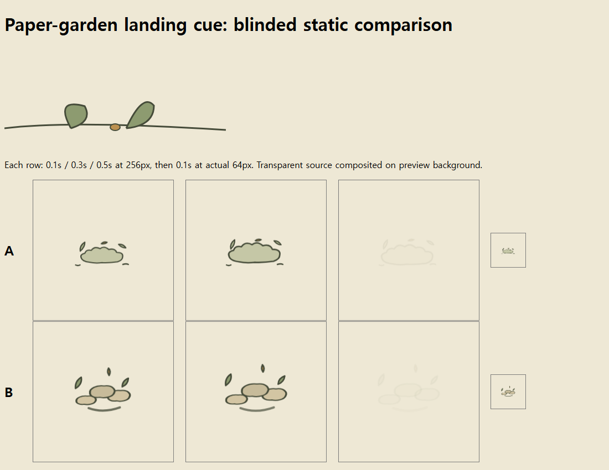

# game-vfx v0.4.1 paired comparison — 2026-11-06

[English](comparison-2026-11-06.md) | [한국어](comparison-2026-11-06.ko.md)

**Follow-up recheck:** The 90/90 scores below describe the original checks. In the added pending-completion callback case, the baseline passed and the full-skill submission failed. Original submissions, scores and hashes are preserved; see the [separate correction and regression results](recheck-followup-2026-11-06.md).

**This small pilot did not establish an additional quality advantage for the full skill.** Both conditions passed 90/90 common functional checks. One blinded AI review of one style task preferred the baseline. This does not establish that the baseline is always better.

## Method

Twelve independent GPT-6 Sol sessions with medium reasoning covered six tasks under two conditions. Requests and starting files were identical within each pair. The baseline received a short instruction to create the requested effect, preserve game rules and inspect the output. The full condition received the revised v0.4.1 instructions, references and bundled assets. This compares the added value of the whole package, not instruction length alone.

Working directories were separate and execution order was randomized in advance. Up to four sessions ran concurrently on the same Windows host. Each session was asked to spend about four minutes; actual execution took 136–210 seconds, including tool startup, checks, revisions and final responses, but excluding queue time. Tools were Node 22.18.0, installed Playwright/Chromium and Godot 4.7.1.

Recoloring, reduced motion and Godot import modified existing examples. The style task used a new paper-garden reference scene; loop and event tasks used newly specified synthetic requirements. No released game or real network was evaluated. The event contract explicitly required one full 0.8-second confirmed phase even when confirmation arrived after preview expiry.

The coordinator wrote held-out checkers while producers worked. Identical checks were applied without changing submissions. A separate Sol reviewer received condition-blinded A/B style captures without production history, expected scores or automated results.

## Results

| Task | Baseline functional checks | Full-skill functional checks | Baseline time | Full-skill time |
| --- | ---: | ---: | ---: | ---: |
| Recolor | 6/6 | 6/6 | 145 s | 162 s |
| Paper-garden style creation | 4/4 | 4/4 | 136 s | 210 s |
| Looping embers | 7/7 | 7/7 | 141 s | 153 s |
| Reduced motion and state distinction | 6/6 | 6/6 | 156 s | 139 s |
| Godot import | 54/54 | 54/54 | 200 s | 156 s |
| Delayed/duplicate events | 13/13 | 13/13 | 172 s | 164 s |
| Total | **90/90** | **90/90** | **950 s** | **984 s** |

Ninety checks are not ninety independent samples. In particular, Godot's 54 comprise six valid-input checks and 48 rejection/state-preservation checks for 24 malformed inputs. Both conditions had clean import/runtime exit codes of zero and no script errors in the fresh checking environment. Checks cover alpha, lifetime, determinism, loop seams, reduced motion and the event contract; they are not artistic-quality scores.

### Blinded style review

In the final anonymization, A was the baseline and B the full skill. The reviewer did not see that mapping.

| Criterion, five-point scale | Baseline A | Full skill B |
| --- | ---: | ---: |
| Reference style fit | 4 | 3 |
| Readability at 64 px | 4 | 3 |
| Visually assessable requirement fit | 4 | 3 |

The reviewer found A's connected cloud silhouette clearer as landing dust. B's separated ovals resembled pebbles or bubbles, while its lower curve read as a partial ring. Both retained the broad direction of muted colors and flat outlines. This was one AI reviewing still captures of one task, not evidence of human preference or continuous motion quality.

### Work performed

| Cumulative metric across six production sessions | Baseline | Full skill |
| --- | ---: | ---: |
| Input tokens, including cached tokens | 2,189,275 | 2,748,621 |
| Uncached input tokens | 86,107 | 105,805 |
| Output tokens | 39,757 | 39,149 |
| Worker-reported revisions | 9 | 8 |

The full condition used about 3.5% more total time and 22.9% more uncached input, with about 1.5% less output. These are cumulative CLI usage counts across tool calls, not unique document lengths or billing amounts. Self-reported revisions are not the same metric as checker retries. A single run on a shared host cannot establish general speed or cost differences. Reviewer and common-checker work is excluded.

## Verification, isolation and limits

- All twelve sessions completed. Failed sessions were not dropped or favorable outputs selected through reruns. Raw logs retain command, patch and checker retries. The shared environment logged unnecessary local MCP connection errors, but required tool checks ultimately completed.
- Paired REQUEST.md files were checked for equality. Command records showed no evidence that the baseline read the full skill. One baseline reduced-motion session unsuccessfully tried to list a nonexistent `skill` directory. The host may expose a global skill catalog, and file-access isolation relies on instructions, so this was not a fully blinded environment.
- Full-skill sessions read relevant references. Skill hashes, requests, submission hashes and file-read records were retained. The evaluated skill was not automatically modified afterward.
- The first event check falsely failed on `0.3999999999999999 === 0.4`. The checker was corrected to use a 1e-9 tolerance for both conditions. Implementations were unchanged and pre-correction results retained.
- Loop/reduced-motion time samples and still captures were checked. Human real-time motion review, physical-device performance and released-game integration were not tested. Godot checks were headless.
- There is one sample per condition/task. Detailed requests gave the baseline strong requirements too. This does not test whether the skill discovers omitted requirements in ambiguous real requests; a ceiling effect may let both conditions pass easily.

## Interpretation and next improvements

Current evidence does not justify describing the skill as a method that always produces better VFX. It supports providing conditional creation and verification procedures. For clear, simple tasks, this run found no evidence that the extra documents improved quality.

Keep conditional references rather than adding more rules now. Future evaluation should use real game references, requests with omitted requirements, repeated runs and multiple reviewers. Do not turn the preference in this single style task into a universal shape rule.

## Reproduction material

- [Setup, twelve requests and condition mapping](evidence/comparison-2026-11-06/manifest.json)
- [Predefined criteria and checker correction](evidence/comparison-2026-11-06/PROTOCOL.md)
- [Raw functional results](evidence/comparison-2026-11-06/verification.json), [Godot results](evidence/comparison-2026-11-06/godot-verification.json)
- [Blind scores and rationale](evidence/comparison-2026-11-06/blind-review/score.json), [anonymization key](evidence/comparison-2026-11-06/blind-key.json)
- [Skill hashes](evidence/comparison-2026-11-06/skill-hashes.json), [execution times](evidence/comparison-2026-11-06/execution.json), [submission/tool/file-read audit](evidence/comparison-2026-11-06/submission-audit.json)

The [public reproduction package](evidence/comparison-2026-11-06/README.md) contains all twelve submissions and common checkers. Submitted sources were not changed after evaluation. Tool paths and output locations were adjusted for portable checking without overwriting original judgments. Public audit records omit personal computer paths, session IDs, raw shell commands and host logs. Full originals remain in the local experiment folder.
