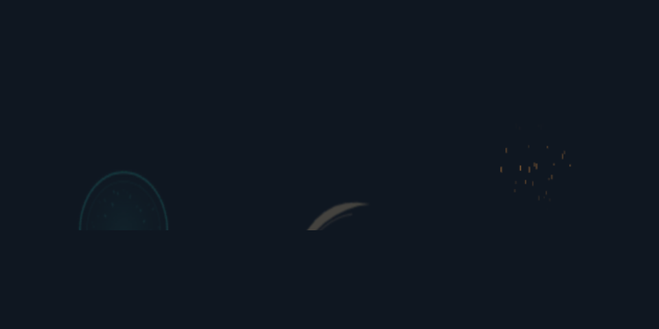
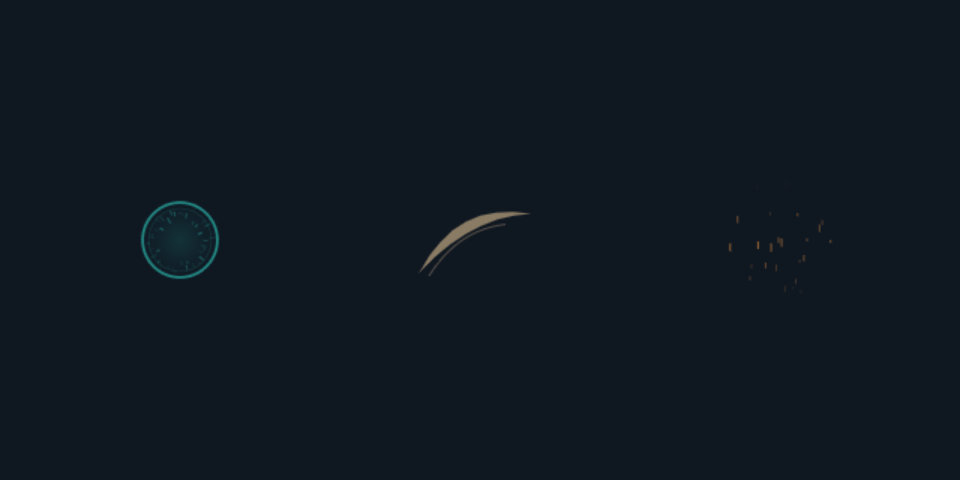

# 실제 Unity VFX 실험 — 2026-11-06

[English](unity-experiment-2026-11-06.md) | [한국어](unity-experiment-2026-11-06.ko.md)

**실제 Unity Editor Play Mode와 GPU에서 두 버전을 실행했다. 두 버전 모두 VFX 기능 검사 32/32개를 통과했지만, Unity 검색 인덱스의 내부 예외가 있어 전체 실행 결과는 실패로 유지했다.** 새 효과의 미적 우위나 스킬 A/B 비교를 측정한 실험은 아니다.

| 환경 | 기능 검사 | 실행 중 오류 | 전체 결과 |
| --- | ---: | --- | --- |
| Unity 6000.4.0f1 / WindowsEditor / Direct3D11 / RTX 3080 Laptop GPU | 32/32 | UnityEditor.Search의 ArgumentOutOfRangeException | passed=false |
| Unity 6000.5.7f1 / 같은 GPU·API | 32/32 | 같은 검색 인덱스 예외 | passed=false |

독립 테스트 프로젝트에서 기존 충격파·베기·반복 불씨 PNG/JSON을 SpriteRenderer로 재생했다. Unity 기본 Particle System으로 12개 입자 생성, 소멸, 최대 64개 제한, 취소도 검사했다. 24개 효과 중첩 종료, 소유자 제거, 일시정지·재개, 두 주기 이상 반복, 밝고 어두운 배경 캡처, 시뮬레이션 시간 배율 보존을 확인했다. URP/HDRP·VFX Graph·모바일·독립 실행 게임 빌드·실제 네트워크는 검사하지 않았다.

## 실험에서 발견하고 수정한 문제

초기 Unity 가져오기는 512×384 PNG를 기본 NPOT 설정으로 512×512로 바꿨다. 원본 JSON의 프레임 좌표가 실제 텍스처와 어긋나 충격파 아래쪽이 잘렸다. `TextureImporterNPOTScale.None`으로 원본 크기를 보존하고, 메타데이터와 실제 Texture2D 크기를 비교하는 검사 3개를 추가했다. 수정 후 두 엔진에서 잘림이 사라진 캡처를 직접 열어 확인했다. 이는 새 Unity 샘플 어댑터의 가져오기 설정 문제였으며, 기존 Canvas 출력 자체의 오류로 판단하지 않는다.

초기 테스트 코드의 C# 타입/메서드 이름 충돌도 수정한 뒤 엔진 검사를 진행했다. 이 컴파일 실패를 성공한 실행으로 세지 않았다.

## 관측한 시간

각 one-shot을 워밍업 후 3회 반복했다. 선언 시간은 충격파 0.6초, 베기 0.4초다.

| 엔진 | 충격파 완료 | 베기 완료 |
| --- | --- | --- |
| 6000.4.0f1 | 0.600074–0.600185초 | 0.400053–0.400224초 |
| 6000.5.7f1 | 0.600017–0.600133초 | 0.400055–0.400223초 |

이 값은 해당 Editor Play Mode 실행에서 Update가 완료를 관측한 벽시계 시간이다. 실제 표시 지연이나 다른 기기의 정확성을 보증하지 않는다. 검사 허용 오차는 관측 프레임 간격에 기반하며, 관측 결과가 1ms 이내였다는 사실과 검사 허용 오차는 서로 다르다. 캡처를 만드는 비용은 시간 측정 반복에서 제외했다.

## 남은 사항과 증거

두 실행의 오류 스택은 VFX 코드가 아닌 `UnityEditor.Search.SearchDatabase.GetDefaultSearchDatabase`와 `SearchInit.IndexationOnStartup`을 가리킨다. [오류 스택](evidence/unity-2026-11-06/editor-error.txt)을 보존했고, 오류를 무시하거나 성공 판정에서 제외하지 않았다. 오류의 근본 원인을 확정하거나 전역 Unity 설정을 변경하지 않았다. Unity의 [검색 인덱싱 문서](https://docs.unity.com/en-us/engine/6000.3/manual/unity-editor/editor-navigating-managing/editor-searching/search-overview/search-indexing/search-index-manager)는 해당 에디터 기능의 범위를 설명한다.

밝은 배경에서는 베기·불씨의 대비가 낮게 보인다. 이번 작업은 기존 에셋의 엔진 재생 시험이므로 원본 색과 알파를 임의로 재설계하지 않았다. 네이티브 파티클은 기본 사각 입자로 만든 동작 검사이며, 스타일 완성품이 아니다. 연속 재생은 엔진에서 실행했지만 사람의 체감 동작·선호를 평가하지 않았고 영상 감상 검증도 하지 않았다.

- [Unity 프로젝트와 실행 명령](../examples/unity-vfx/README.ko.md)
- [6000.4 결과](evidence/unity-2026-11-06/6000.4/results.json), [6000.5 결과](evidence/unity-2026-11-06/6000.5/results.json), [소스 해시](evidence/unity-2026-11-06/source-hashes.json)
- [밝은 배경](evidence/unity-2026-11-06/6000.5/light.png), [24개 중첩](evidence/unity-2026-11-06/6000.5/overlap.png), [네이티브 파티클](evidence/unity-2026-11-06/6000.5/native-particles.png), [취소 후 빈 화면](evidence/unity-2026-11-06/6000.5/cancelled.png)

전체 로컬 로그와 순서대로 캡처한 프레임은 예제의 무시된 `output/`에 남겼다. 저장소에는 위에 링크한 결과와 대표 캡처를 포함했다.
