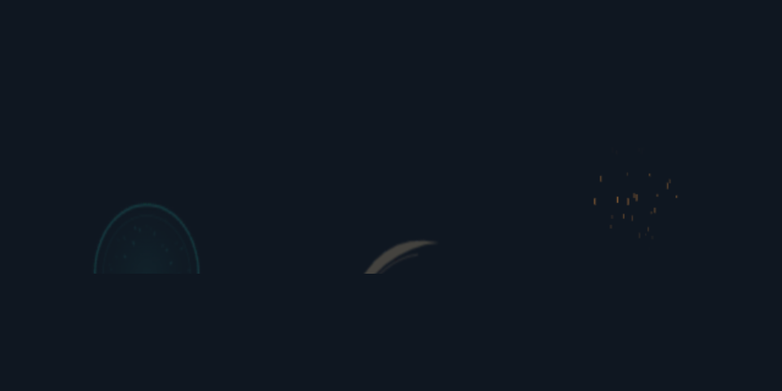
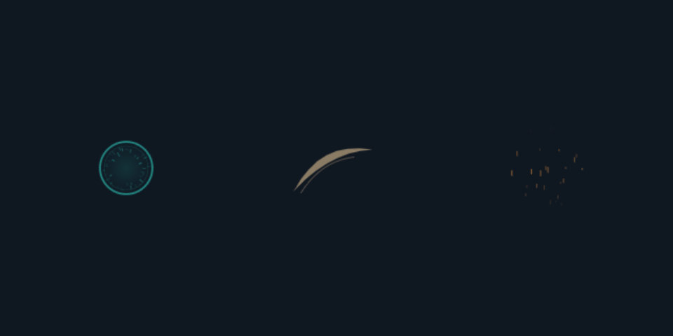

# Actual Unity VFX experiment — 2026-11-06

[English](unity-experiment-2026-11-06.md) | [한국어](unity-experiment-2026-11-06.ko.md)

**Two Unity versions ran in actual Editor Play Mode with GPU rendering. Both passed 32/32 VFX functional checks, but an internal Unity Search indexing exception keeps both overall runs marked failed.** This was not a study of artistic superiority or a skill A/B comparison.

| Environment | Functional checks | Runtime error | Overall result |
| --- | ---: | --- | --- |
| Unity 6000.4.0f1 / WindowsEditor / Direct3D11 / RTX 3080 Laptop GPU | 32/32 | ArgumentOutOfRangeException in UnityEditor.Search | passed=false |
| Unity 6000.5.7f1 / same GPU and API | 32/32 | Same Search indexing exception | passed=false |

An isolated test project played the existing impact, slash and looping-ember PNG/JSON sheets with SpriteRenderer. Unity's native Particle System was checked for a twelve-particle burst, expiry, a 64-particle limit and cancellation. Checks covered completion of 24 overlapping effects, owner removal, pause/resume, more than two loop periods, light/dark captures and unchanged simulation time scale. URP/HDRP, VFX Graph, mobile, standalone game builds and real networks were not tested.

## Problem found and corrected

The initial Unity import resized 512×384 PNGs to 512×512 under the default NPOT setting. Original JSON frame coordinates no longer matched the texture, cropping the lower part of the impact. Setting `TextureImporterNPOTScale.None` preserves the original dimensions; three checks now compare metadata with actual Texture2D sizes. Corrected captures from both engines were opened and no longer showed cropping. This was an import-setting problem in the new Unity sample adapter, not a diagnosed defect in the existing Canvas export.

An initial C# type/method naming collision in the test code was also corrected before running the engine checks. That compilation failure was not counted as a successful run.

## Observed timing

Each one-shot ran three warmed trials. Declared durations were 0.6 seconds for impact and 0.4 seconds for slash.

| Engine | Impact completion | Slash completion |
| --- | --- | --- |
| 6000.4.0f1 | 0.600074–0.600185 s | 0.400053–0.400224 s |
| 6000.5.7f1 | 0.600017–0.600133 s | 0.400055–0.400223 s |

These are wall-clock times when Update observed completion in those Editor Play Mode runs. They do not guarantee display latency or accuracy on other devices. Acceptance uses observed frame intervals; an observed error below 1 ms is distinct from the acceptance tolerance. PNG capture work was excluded from timing trials.

## Remaining issues and evidence

Both error stacks point to `UnityEditor.Search.SearchDatabase.GetDefaultSearchDatabase` and `SearchInit.IndexationOnStartup`, rather than VFX code. The [error stack](evidence/unity-2026-11-06/editor-error.txt) is preserved and the exception was not ignored or excluded from the success decision. Its root cause was not established, and global Unity settings were not changed. Unity's [Search indexing documentation](https://docs.unity.com/en-us/engine/6000.3/manual/unity-editor/editor-navigating-managing/editor-searching/search-overview/search-indexing/search-index-manager) describes the Editor feature's scope.

Slash and embers have low contrast on the light background. This experiment tested engine playback of existing assets, so their colors and alpha were not redesigned. Native particles are basic squares used for behavior checks, not a finished art asset. Continuous playback ran in the engine, but human motion comfort/preference and video viewing were not evaluated.

- [Unity project and command](../examples/unity-vfx/README.md)
- [6000.4 results](evidence/unity-2026-11-06/6000.4/results.json), [6000.5 results](evidence/unity-2026-11-06/6000.5/results.json), [source hashes](evidence/unity-2026-11-06/source-hashes.json)
- [Light background](evidence/unity-2026-11-06/6000.5/light.png), [24 overlapping effects](evidence/unity-2026-11-06/6000.5/overlap.png), [native particles](evidence/unity-2026-11-06/6000.5/native-particles.png), [empty scene after cancellation](evidence/unity-2026-11-06/6000.5/cancelled.png)

Full local logs and sequential captures remain in the example's ignored `output/` directory. The repository includes the linked results and representative captures.
