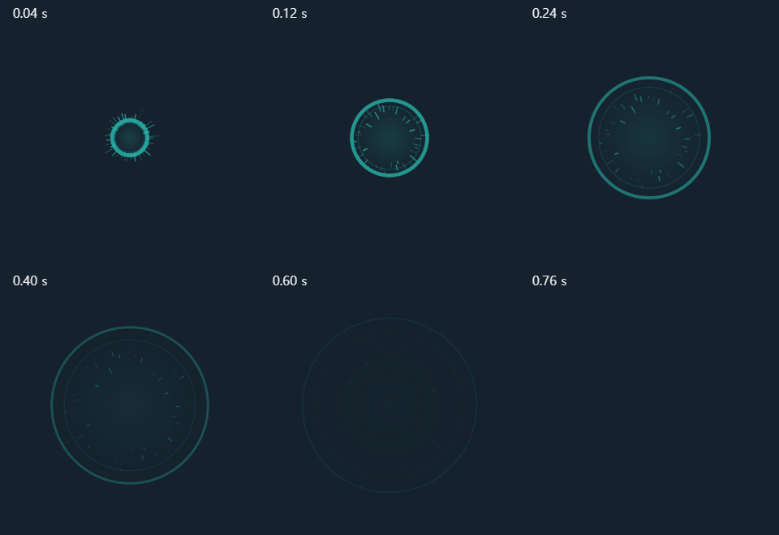

# Validation / 검증 기록

Date: 2026-11-04. Keep package validation, example execution, and the effectiveness of a skill separate.

기준일: 2026-11-04. 패키지 검사, 예제 실행, 스킬 자체의 효과는 서로 다른 검증입니다.

## Package and handoff / 패키지와 스킬 연계

The installed game-vfx v0.2.0 and bettermakegame handoff instructions passed the skill validator, YAML parsing, local reference checks, and whitespace checks. The publication copies are checked against the installed skill files. This establishes packaging consistency, not successful cross-host activation or better artistic judgment.

설치된 game-vfx v0.2.0과 bettermakegame의 연계 지침은 스킬 검사기, YAML 파싱, 상대 참조, 공백 오류 검사를 통과했습니다. 공개 사본도 설치 파일과 비교합니다. 이는 패키지의 일관성을 확인한 것이며, 여러 호스트에서의 활성화나 미적 판단 향상을 입증하지 않습니다.

Independent end-to-end style handoff evaluation: **NOT RUN**. No before/after quality percentage, user preference, or performance gain is claimed.

스타일 연계의 독립적인 전체 실행 평가: **NOT RUN(미실행)**. 변경 전후 품질 향상률, 사용자 선호, 성능 개선 수치를 주장하지 않습니다.

## 2D example / 2D 예제

The [Canvas record](evidence/canvas-2026-11-04.json) contains 23 checks from Chrome 156.0.8078.80. They cover seeded/time-based reproducibility, empty start/end, sampled frame bounds, partial/zero alpha, playback/pause/replay, downloads, dimensions, metadata, and frame order. Each saved sheet frame matched its individually exported PNG after equivalent PNG roundtrips. Final contact-sheet and page captures were opened with an image-viewing tool.

[Canvas 기록](evidence/canvas-2026-11-04.json)은 Chrome 156.0.8078.80의 검사 23개를 담고 있습니다. 시드·시간 재현성, 시작·종료, 표본 시점의 경계, 투명도, 재생·멈춤·재실행, 다운로드, 크기·메타데이터·프레임 순서를 확인했습니다. 양쪽 모두 PNG로 저장·다시 읽는 조건에서 시트 프레임과 개별 프레임이 일치했습니다. 최종 프레임 모음과 페이지 캡처를 이미지 도구로 열었습니다.

This is a historical same-day run of the bundled example, not a new behavioral evaluation of v0.2.0. It does not establish real-time motion preference or import into another engine.

이 기록은 포함된 예제의 같은 날 이전 실행이며, v0.2.0 지침에 대한 새로운 행동 평가가 아닙니다. 실제 속도의 움직임 선호나 다른 엔진으로의 가져오기를 입증하지 않습니다.

## 3D example / 3D 예제

The [3D record](evidence/shockwave-3d-2026-11-04.json) records 28 browser checks. The observed setup used Windows, Chrome 156.0.8078.80, Three.js 0.187.0, and ANGLE Direct3D11 on Intel UHD Graphics. The portable test entrypoint and dependency lock are included with the example.

[3D 기록](evidence/shockwave-3d-2026-11-04.json)은 브라우저 검사 28개를 담고 있습니다. 확인한 환경은 Windows, Chrome 156.0.8078.80, Three.js 0.187.0, Intel UHD Graphics의 ANGLE Direct3D11입니다. 예제에 실행 환경을 지정할 수 있는 검사 스크립트와 의존성 잠금 파일을 포함했습니다.

- A front-pillar mask selected 13,228 interior pixels. With the pillar present, toggling the effect changed none of those sampled pixels; removing it revealed effect differences at 6,658 of them.
- Six separate effect owners rendered simultaneously.
- Twenty clear/recreate cycles returned to one requested owner. Tracked geometries stayed at 10, textures at 1, and shader programs at 6.
- Other checks cover seeking, empty endpoints, playback/pause/replay, reduced motion, pointer/keyboard camera movement, PNG export, narrow layout, teardown/re-entry, offline operation, and logged errors.

- 앞 기둥 내부의 13,228개 픽셀을 골라 비교했습니다. 기둥이 있을 때 효과 켜기·끄기로 달라진 픽셀은 없었고, 기둥을 숨기면 그중 6,658개에서 효과 차이가 나타났습니다.
- 별도로 생성한 효과 6개가 동시에 렌더링되었습니다.
- 생성·삭제를 20회 반복한 뒤 요청한 효과 한 개만 남았습니다. 추적한 지오메트리는 10개, 텍스처는 1개, 셰이더 프로그램은 6개로 유지되었습니다.
- 그 밖에 시간 이동, 시작·종료, 재생·멈춤·재실행, 움직임 줄이기, 마우스·키보드 카메라 조작, PNG 저장, 좁은 화면, 정리·재진입, 오프라인 실행, 기록된 오류를 확인했습니다.

Final isometric, side, six-effect, and narrow-layout images were opened for visual inspection. Occlusion was tested at a fixed camera/time/radius, not every combination. Constant resource counters are not a complete heap/GPU leak audit. Actual playback feel, real phone performance, engine ports, and game event integration remain unverified.

최종 사선·측면·6개 효과·좁은 화면 캡처를 직접 열었습니다. 가림 검사는 카메라·시간·반경이 고정된 조건이며 모든 조합을 검증한 것은 아닙니다. 자원 수가 일정하다는 결과도 전체 힙·GPU 메모리 누수 검사는 아닙니다. 실제 재생의 느낌, 휴대폰 성능, 다른 엔진 이식, 게임 이벤트 연결은 미검증입니다.
